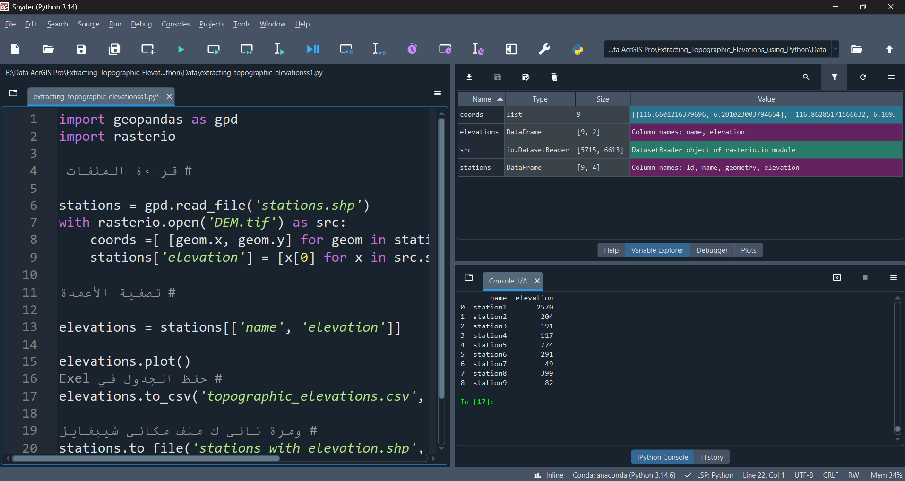
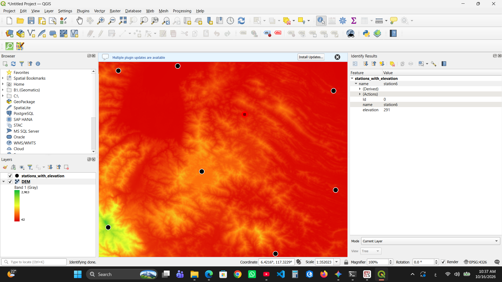

# 🗺️ Automated Topographic Elevation Extractor

An automated Python script designed to extract precise topographic elevation values from a Digital Elevation Model (DEM) raster and map them directly to GIS point stations using spatial processing automation.

---

## 🧰 Tech Stack
* **Python** (Core automation logic)
* **GeoPandas** (Vector spatial data handling & shapefile management)
* **Rasterio** (High-performance raster processing and NumPy matrix sampling)
* **QGIS** (Spatial data visualization and result validation)

---

## 🔄 Workflow Architecture
1. **Load Spatial Data:** Reads point stations (`.shp`) and the Digital Elevation Model (`DEM.tif`).
2. **Spatial Sampling:** Extracts geographic coordinates from vector geometries and queries the underlying raster pixels.
3. **Data Augmentation:** Appends the extracted elevation values as a new attribute column (`elevation`) to the GeoDataFrame.
4. **Dual Exporting:**
   * Exports a clean tabular CSV report (`index=False`) for reports and spreadsheets.
   * Exports an updated GIS-ready Shapefile containing spatial geometry and elevation attributes.

---

## 📊 Execution & Visual Validation

### 1. Python Automation & Spyder IDE Execution
The script successfully processes the raster-vector overlay, outputs tabular results to the console, and updates the spatial dataframe attributes:



---

### 2. QGIS Spatial Validation
The processed vector layer was loaded back into QGIS over the colored DEM raster. Spatial inspection (`Identify Results`) verifies the absolute accuracy of the extracted elevation value:



---

## 🚀 How to Run
```bash
python extracting_topographic_elevations.py
